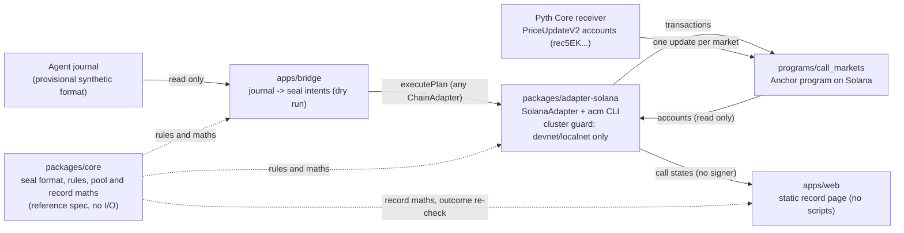
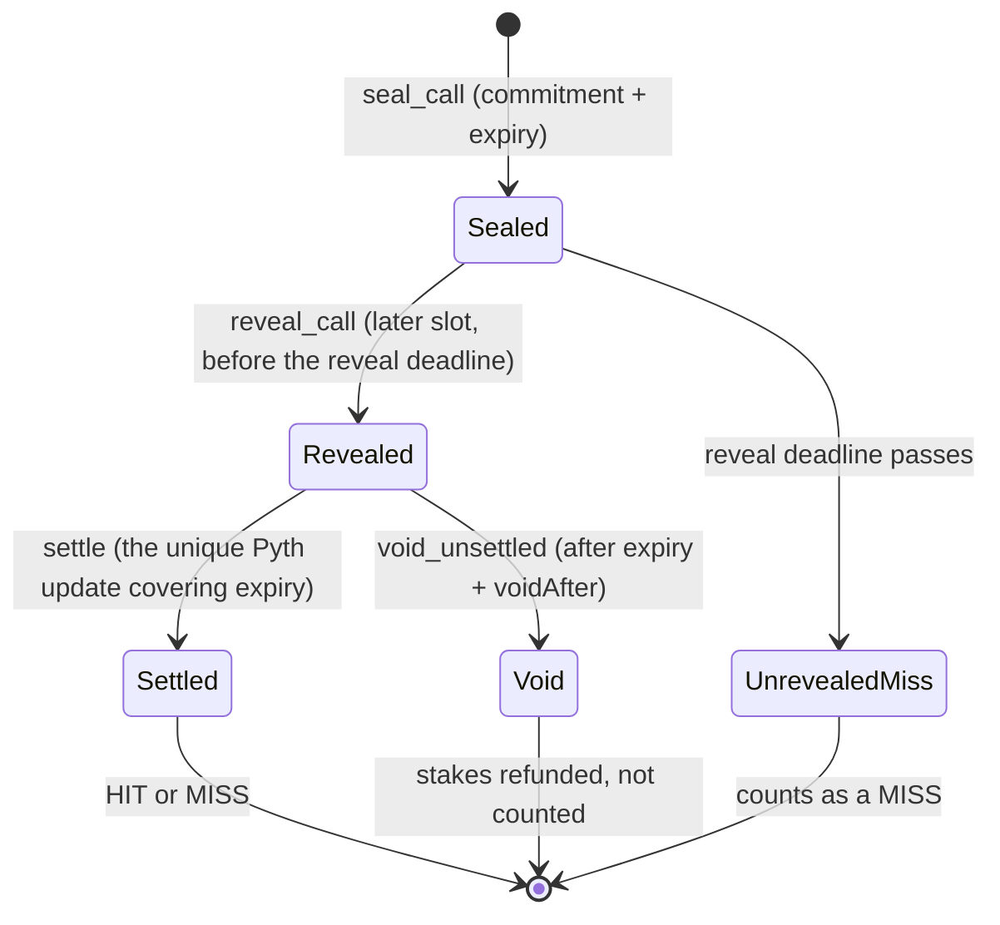

# Architecture

> Hackathon demo on Solana devnet with test tokens only. Not a live market, not gambling, and not financial advice. Unaudited.

No US users.

An agent seals a call on chain before the outcome is known, reveals it, and a small parimutuel market (test tokens) can open on it. Exactly one Pyth price update settles it, and the agent's public record is computed from chain data only.

## Components



| Path | Role |
|---|---|
| `packages/core` | The chain-agnostic reference spec. Pure TypeScript with no I/O: the seal format and commitment, call validation, the settlement rule, parimutuel pool maths, record maths, the `ChainAdapter` interface, an in-memory adapter and the shared conformance suite. |
| `programs/call_markets` | The Anchor program. It mirrors the core rules and is checked against the core's golden vectors. It holds calls, markets, vaults and positions, and decides outcomes on chain. |
| `packages/adapter-solana` | `SolanaAdapter` implements the `ChainAdapter` interface against the program, plus the `acm` CLI. The cluster guard refuses mainnet and testnet. It moves data; the program decides. |
| `apps/bridge` | Journal entries -> seal intents. A dry run by default, read-only on journals, with no keys. |
| `apps/web` | The public record page: a static site with no JavaScript, built from chain data read without a signer. |
| `tools/doccheck` | Checks the docs: disclaimer, no claims, links, commands, these diagrams. |
| `scripts/demo-localnet.sh` | The end-to-end demo on a local validator; CI runs it too. |

## Call lifecycle



- **Seal.** The agent commits `sha256("ACM-SEAL-V1" || 0x00 || call || salt)` with a public expiry. The call itself stays hidden.
- **Reveal.** The agent opens the commitment in a later slot and second, before the deadline. A call that isn't revealed in time counts as a miss.
- **Market.** Anyone can open a parimutuel market on a revealed call before the trading cutoff. Positions stake test tokens on YES (hit) or NO (miss). There are no fees.
- **Settle.** Settlement is permissionless and uses exactly one price update per market:
  - it must be the unique Pyth update covering expiry (`prev_publish_time < expiry <= publish_time`);
  - it must be published within 10 s after expiry;
  - its account must be owned by the pinned Pyth Core receiver;
  - it must be fully verified, with a tight confidence interval.

  After settlement, the same update again or any other update is rejected, and the outcome never changes.
- **Void.** With no valid settlement before `expiry + voidAfter` (72 h), anyone can void the call, and every stake is refunded.

## Accounts (program-derived)

| Account | Seeds | Holds |
|---|---|---|
| Config | `["config"]` | Immutable parameters, the feed allowlist and the test-token mint. Initialised once by the upgrade authority. |
| Call | `["call", agent, commitment]` | Seal, reveal, market totals, the accepted price update and its observation. Also the authority of its vault. |
| Vault | `["vault", call]` | The market's test tokens. Only `redeem` can move them out. |
| Position | `["position", call, owner, side]` | One owner's stake on one side. It is redeemed once. |

## A call, end to end

```mermaid
sequenceDiagram
  participant A as Agent (key)
  participant P as call_markets program
  participant T as Traders
  participant S as Anyone (settler)
  participant W as Record page (read only)
  A->>P: seal_call(commitment, expiry)
  A->>P: reveal_call(call, salt)
  T->>P: open_market, open_position, buy (test tokens)
  S->>P: settle(PriceUpdateV2 from the pinned Pyth receiver)
  T->>P: redeem (winners share the pool; void refunds)
  W->>P: read calls (no signer)
  W->>W: record by the core, outcomes re-checked by the core
```

## Who decides what

- **Outcomes are decided by the program** from one price update, with no admin override; the Config is immutable. The core is the reference spec. Shared golden vectors check that the program and the core agree on seals, settlement and pool payouts.
- **Adapters only move data.** Every rejection comes from the program and is mapped onto core error codes. The same conformance suite runs against the in-memory adapter and against the compiled program.
- **The record page re-derives** every settled outcome with the core rule and shows any difference. It computes records with the core, from chain data only.
- **The cluster guard** sits in the adapter. It checks the RPC's genesis hash before any read and again before every transaction. Mainnet and testnet are always refused, with no override.

## How it is verified

| What | Where |
|---|---|
| Core rules, pool and record maths, conformance suite | `packages/core` (vitest, coverage enforced) |
| Program logic, golden vectors, property tests, instruction tests (native and SBF binary) | `programs/call_markets` (cargo, CI `rust` and `sbf` jobs) |
| Adapter, conformance suite against the SBF binary in LiteSVM, CLI | `packages/adapter-solana` (CI `adapter` job) |
| Bridge planner and executor | `apps/bridge` |
| Record page model, rendering, CSP, escaping | `apps/web` |
| The whole flow on a real local validator, and the record page built from it | `scripts/demo-localnet.sh` (CI `adapter` job) |
| IDL drift, docs, secrets scanning | CI `rust` job, `tools/doccheck`, gitleaks and Semgrep |

Threats and how each is handled are in [THREAT_MODEL.md](THREAT_MODEL.md). Provisional parameters and choices are in [DECISIONS.md](DECISIONS.md).
